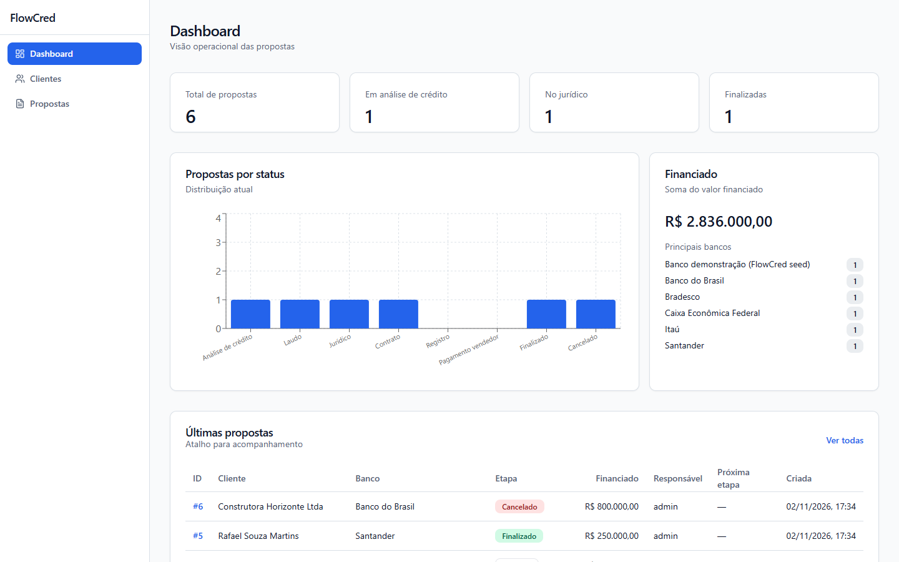
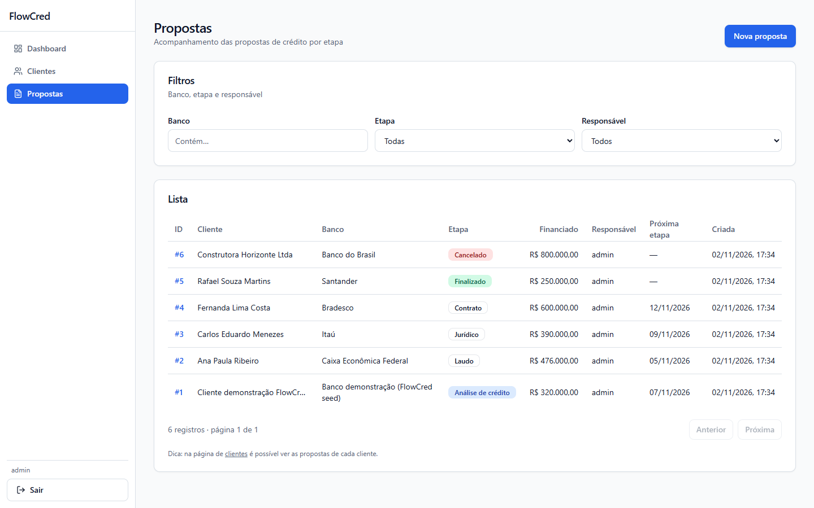
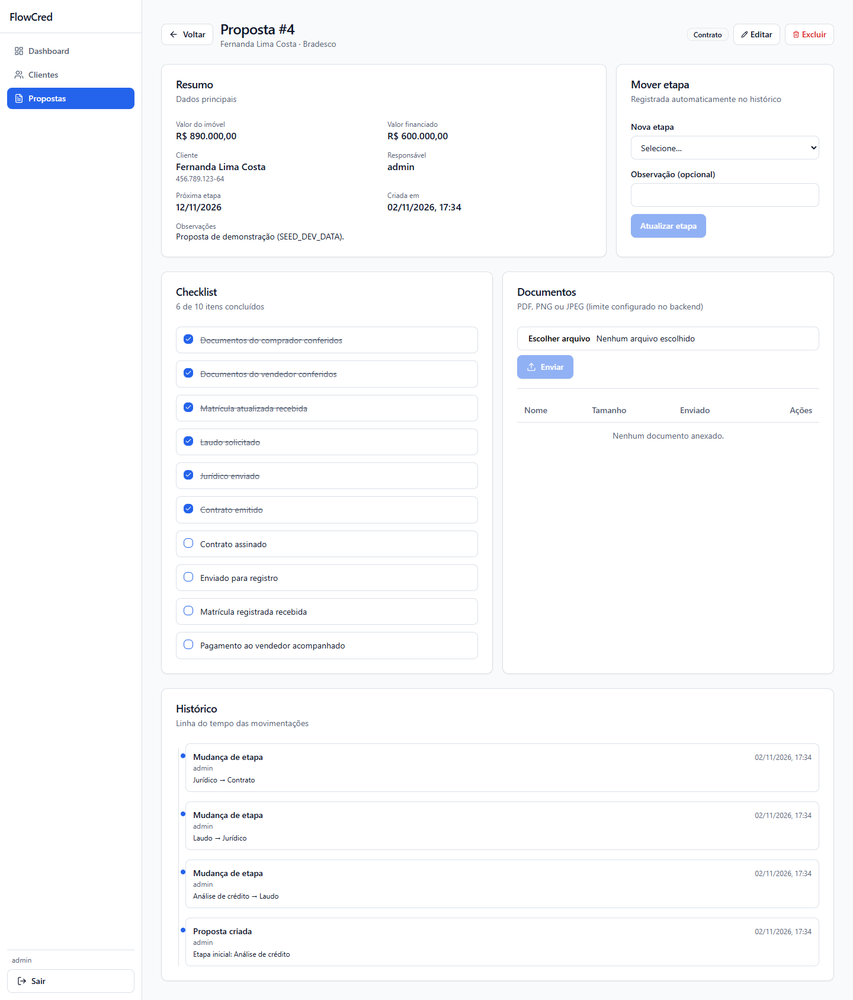
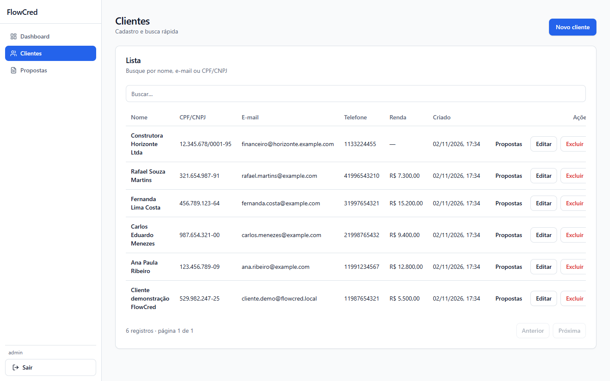
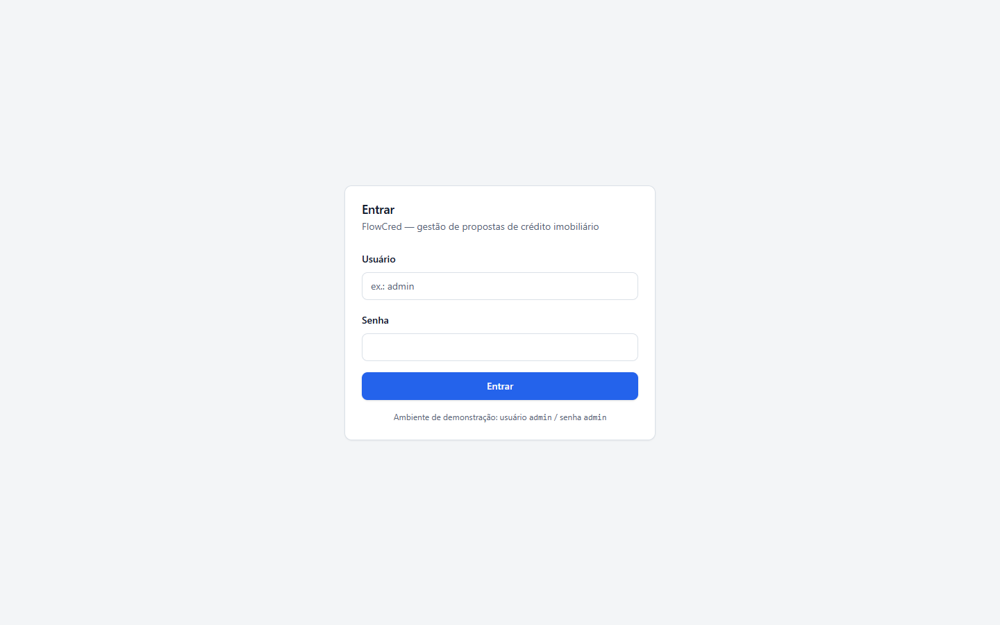
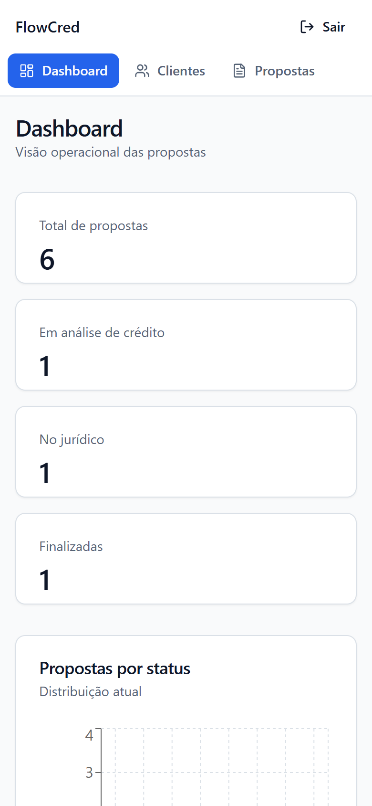

# FlowCred — Frontend

[](https://github.com/augustoemiliano/FlowCred-Front/actions/workflows/ci.yml)

Interface web do **FlowCred**, sistema de gestão de propostas de **crédito imobiliário**. Permite acompanhar cada proposta pelas etapas do financiamento (análise de crédito → laudo → jurídico → contrato → registro → pagamento ao vendedor → finalizado), com clientes, bancos, valores do imóvel e do financiamento, checklist, documentos, histórico de movimentações e dashboard operacional.

Consome a API do repositório [FlowCred-Back](https://github.com/augustoemiliano/FlowCred-Back) (FastAPI).

## Demo online

- **App:** https://flowcred-front.onrender.com (usuário `demo` / senha `demo`)

> Link previsto pelo `render.yaml` do FlowCred-Back; fica ativo depois que o Blueprint for aplicado no Render.

No Render o front é um **static site** (`npm ci && npm run build`, publica `dist/`, rewrite `/*` → `/index.html`). Ele chama a API diretamente em `https://flowcred-back.onrender.com/api/v1` (`VITE_API_URL`), com CORS liberado no back para a origem do front e autenticação por header `Authorization: Bearer`.

### Como publicar (dono do repositório)

O [`render.yaml`](https://github.com/augustoemiliano/FlowCred-Back/blob/main/render.yaml) do FlowCred-Back é um *Blueprint* que cria **os dois serviços** (API e front) de uma vez:

1. Crie uma conta em [render.com](https://render.com) com **Sign in with GitHub** e autorize o app do Render a acessar **os dois repositórios** (`FlowCred-Back` e `FlowCred-Front`).
2. No dashboard: **New → Blueprint**.
3. Escolha o repositório **FlowCred-Back** (branch `main`); o Render lê o `render.yaml` e lista `flowcred-back` (Docker, free) e `flowcred-front` (static site).
4. Clique em **Apply** (nenhum cartão é necessário no plano free) e aguarde o primeiro deploy (~5 min).
5. Abra https://flowcred-front.onrender.com e entre com `demo` / `demo`. Se o Render tiver atribuído outro subdomínio a algum serviço, ajuste `BACKEND_CORS_ORIGINS` (back) e `VITE_API_URL` (front) no dashboard e faça **Manual Deploy** do front.

> **Plano free:** a API hiberna após ~15 min sem acesso, e o primeiro acesso depois disso demora **~1 min** (o front mostra erro de conexão até ela acordar; basta tentar de novo). Não há disco persistente: o banco SQLite e os uploads **voltam aos dados demo a cada deploy, reinício ou hibernação**. Para manter dados, o `render.yaml` traz comentada a opção de Postgres free do Render (expira após 30 dias).

## Screenshots



| Propostas | Detalhe da proposta |
|---|---|
|  |  |

| Clientes | Login | Celular |
|---|---|---|
|  |  |  |

## Stack

- **React 19** + **TypeScript** + **Vite 6**
- **React Router 7**, **TanStack Query 5**, **Axios**
- **React Hook Form** + **Zod 4** (validação de formulários)
- **TailwindCSS 3** com componentes no estilo **shadcn/ui** (Radix UI + CVA), ícones **lucide-react**
- **Recharts** (gráfico do dashboard)
- **Vitest** + **Testing Library** (testes), **ESLint** (typescript-eslint, react-hooks)
- Docker (build estático servido por **nginx**), GitHub Actions

## Funcionalidades

- **Login** com JWT; sessão guardada no navegador e encerrada automaticamente quando o token expira.
- **Dashboard**: total de propostas, em análise, no jurídico, finalizadas, soma financiada, gráfico por etapa, principais bancos e últimas propostas.
- **Clientes**: lista com busca (nome, e-mail, CPF/CNPJ) e paginação; criar, editar e excluir; CPF/CNPJ formatado; atalho para as propostas do cliente.
- **Propostas**: filtros por banco, etapa, responsável e cliente; paginação; nova proposta com escolha de cliente e responsável e validação (financiado ≤ valor do imóvel).
- **Detalhe da proposta**: resumo, edição, exclusão, mudança de etapa com observação, checklist com progresso, upload/download/exclusão de documentos (PDF, PNG, JPEG) e linha do tempo do histórico.
- Layout responsivo (menu lateral no desktop, navegação no topo no mobile) e páginas carregadas sob demanda (code splitting).

## Como rodar localmente

Pré-requisitos: Node.js 22+ e o **backend rodando em `http://localhost:8001`** (veja o README do [FlowCred-Back](https://github.com/augustoemiliano/FlowCred-Back): Docker ou uvicorn).

```bash
cp .env.example .env     # Windows: copy .env.example .env
npm install
npm run dev
```

Abra http://localhost:5173. Em desenvolvimento o Vite faz proxy de `/api` para `VITE_PROXY_TARGET` (padrão `http://localhost:8001`), por isso não há problema de CORS.

Build de produção local:

```bash
npm run build
npm run preview          # http://localhost:4173 (também com proxy de /api)
```

## Como rodar com Docker

A imagem faz o build estático e serve com nginx, que também faz proxy de `/api` para o backend.

```bash
# 1) Backend (no diretório FlowCred-Back)
cp .env.example .env && docker compose up -d --build

# 2) Frontend (neste diretório)
docker compose up -d --build
```

Acesse http://localhost:8080. Por padrão o nginx encaminha `/api` para `http://host.docker.internal:8001`; para outro endereço defina `API_UPSTREAM` (ex.: `API_UPSTREAM=http://minha-api:8000 docker compose up -d`).

## Credenciais de demonstração

- **Usuário:** `admin` · **Senha:** `admin`
- Com `SEED_DEV_DATA=1` no backend (padrão do `.env.example`), já existem 6 clientes e propostas em etapas diferentes para explorar o dashboard e o fluxo.

Na demo do Render as credenciais são `demo` / `demo`. São credenciais apenas de desenvolvimento/demonstração. A dica de login na tela aparece no modo dev ou quando `VITE_SHOW_DEMO_LOGIN=true`.

## Scripts

| Comando | Descrição |
|---------|-----------|
| `npm run dev` | Servidor de desenvolvimento (porta 5173) |
| `npm run build` | Typecheck + build de produção em `dist/` |
| `npm run preview` | Serve o build localmente (porta 4173) |
| `npm run typecheck` | Verificação de tipos (`tsc`) |
| `npm run lint` | ESLint |
| `npm test` | Testes (Vitest) — 27 testes |

O workflow [`.github/workflows/ci.yml`](.github/workflows/ci.yml) roda lint, typecheck, testes e build, e depois faz o build da imagem Docker com um smoke test do nginx.

## Variáveis de ambiente

| Variável | Padrão | Descrição |
|----------|--------|-----------|
| `VITE_API_URL` | `/api/v1` | Base da API usada pelo Axios (relativa = mesmo host, via proxy) |
| `VITE_PROXY_TARGET` | `http://localhost:8001` | Destino do proxy `/api` do Vite (`dev` e `preview`) |
| `VITE_SHOW_DEMO_LOGIN` | `false` | Mostra a dica de credenciais na tela de login fora do modo dev |
| `VITE_DEMO_USERNAME`, `VITE_DEMO_PASSWORD` | `admin` / `admin` | Credenciais exibidas nessa dica (no Render: `demo` / `demo`) |
| `API_UPSTREAM` (Docker) | `http://host.docker.internal:8001` | Backend para onde o nginx encaminha `/api` |

## Estrutura

```
src/
├── components/
│   ├── ui/                  # componentes base (button, card, dialog, input, table…)
│   ├── ProposalFormDialog.tsx  # formulário de criação/edição de proposta
│   ├── ProposalsTable.tsx   # tabela de propostas (lista e dashboard)
│   └── …                    # Pagination, StatusBadge, FormField
├── context/AuthContext.tsx  # sessão (token, usuário atual, login/logout)
├── layouts/AppLayout.tsx    # menu lateral / topo mobile
├── lib/                     # cliente Axios, schemas Zod, formatação, token
├── pages/                   # Login, Dashboard, Clientes, Propostas, Detalhe da proposta
├── routes/RequireAuth.tsx   # proteção das rotas autenticadas
├── test/                    # setup e helpers de teste
└── types/domain.ts          # tipos e rótulos do domínio (etapas, histórico)
nginx/                       # configuração do nginx da imagem Docker
```

## Possíveis evoluções

- Notificações (toasts) de sucesso
- Testes E2E (Playwright) cobrindo o fluxo completo com o backend
- Seleção de cliente com busca assíncrona (hoje a lista do formulário carrega os 100 primeiros)
